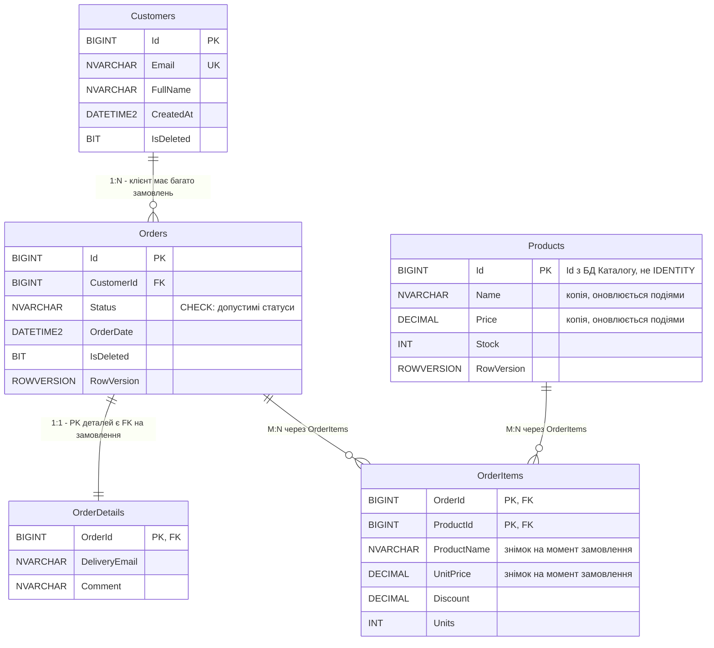
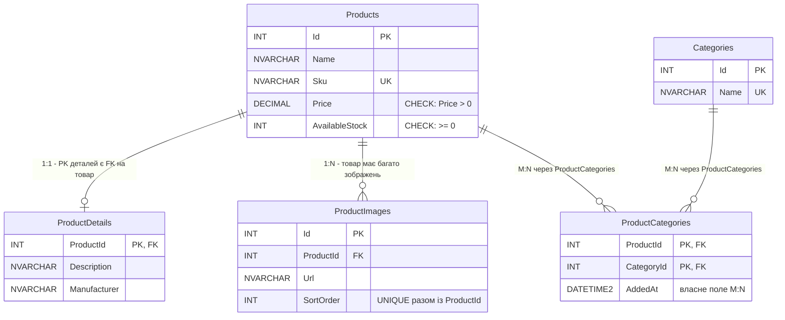

# ERD-діаграми

Позначки: PK - первинний ключ, FK - зовнішній ключ, UK - унікальне значення.
Між базами немає жодних FOREIGN KEY: `Products.Id` у БД Замовлень - це звичайний
стовпець (локальна копія довідника з Каталогу, той самий Id).

## Проєкт №1: БД Замовлень (SQL Server, ADO.NET + Dapper)

## Проєкт №2: БД Каталогу (SQL Server, EF Core Code First)

